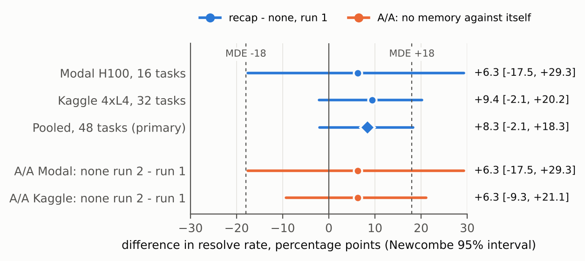
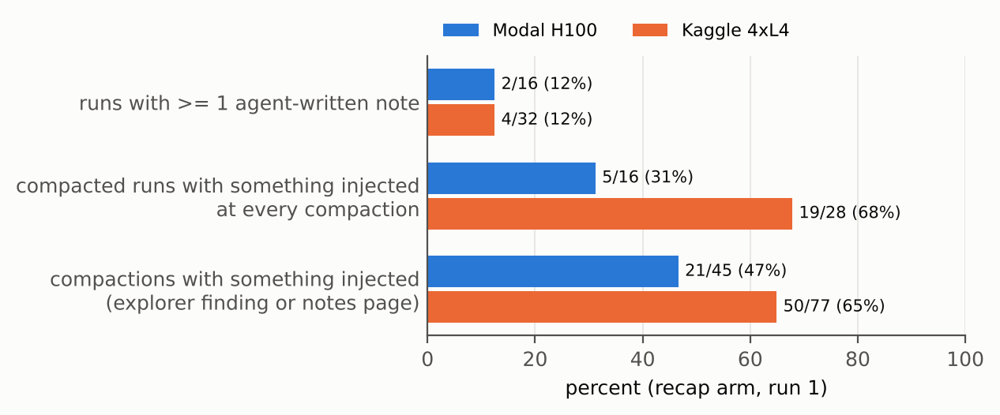

<!--
Kaggle Writeup. Hard limit: 3,000 words, tables and captions included (host ruling); figures and
references do not count. HTML comments are excluded from the count.
Every number comes from results/analysis.json (regenerate: python results/analyze_rows.py), from
DESIGN.md section 10, or, for the delivery counts and the extension overflow and plumbing counts only, from results/run_rows.jsonl through
notebook/paper_figures.py:delivery. paper/check_numbers.py checks each number and the word count.
Run 2 of the Kaggle recap arm is sensitivity only (DESIGN.md, 2026-11-09T07:48Z) and cannot change
the headline.
-->

# One Run Is Not Enough
*Reminding a small Gemma 4 coding agent of its last finding made no measurable difference in a pre-registered test.*

Patrick Passos (Renor)

## Abstract

When a coding agent runs out of room, its earlier findings are cut and it forgets them. We tested a simple fix: automatically putting the agent's last finding back in front of it. We fixed the rules in advance and ran 98 coding tasks with and without this reminder, using a small Gemma 4 model. The reminder made no measurable difference: across all 98 tasks, 47 were solved with it and 48 without. Running the same task twice changed the outcome about one time in five, so a single run on a few dozen tasks cannot show whether memory helps.

In the treatment, the harness re-injects the explorer sub-agent's latest finding into every coder request, plus any notes the agent chose to write. It does **not** test agent-written memory. We compare it with no memory using Gemma 4 31B (QAT,
4-bit) in the Gemma 4 Developer Agent harness, on 98 paired tasks across three backends (Modal H100,
16 tasks; Kaggle 4x L4, 32 tasks; AWS L40S, 50 tasks added in a pre-registered extension).

The pre-registered primary outcome, pooled run-1 resolve rate on the first 48 pairs, was 29/48 with
memory against 25/48 without: +8.3 points, Newcombe 95% interval [-2.1, +18.3], exact McNemar
p = 0.22. The extension, decided after that result, pointed the other way: 18/50 against 23/50,
-10.0 points [-20.2, +0.7], p = 0.125. Combined (secondary, no confirmatory claim), 98 pairs: 47/98
against 48/98, -1.0 points [-8.3, +6.3], p = 1.0. A null result; the sign did not replicate. With 19% of tasks flipping between two identical no-memory runs, the combined 95% interval
excludes harms larger than about 8 points and gains larger than about 6, and the design had 80% power
only for effects of about ±12 points or more. The registered secondary,
repeated actions per compaction, was also null (+0.30 [-4.50, +5.98]). Two directional hypotheses
found on Modal did not replicate on Kaggle. Pre-registered replicate runs of every task (Phase R) are reported separately.

The mechanism findings (first 48 tasks): the model almost never wrote notes (2 of 16
and 4 of 32 runs). Memory costs context: the first request is larger, and the arm compacted more on
Modal. Something was injected at only 47% to 65% of compactions. On two Modal runs, memory coincided with a
`submit_patch` loop. We also report an A/A calibration and a validity funnel (129 tasks, 105 valid).

## 1. Introduction

Agent memory promises that context told once stays available when relevant. For a small agent, that promise first breaks inside a single task. The Gemma 4
harness compacts the conversation when the previous prompt reaches 14,336 tokens. In 16 no-memory
throughput traces, 13 tasks compacted, and 53 of 83 exact repeats of a read, a command or an
explorer question came after a compaction. Experience memory across tasks targets a different
problem, and on coding tasks 11 of 12 pairings did not beat memory-off (VibeMemBench).

**Contributions.**
1. A pre-registered paired comparison, stratified by backend, with a null primary result, a
   pre-registered extension whose sign differs, and intervals that state which effects they exclude.
2. Mechanism findings: adherence, the context cost of memory, delivery rates, and a
   treatment-associated `submit_patch` loop.
3. A measurement method: A/A calibration, a validity funnel, smoke gates,
   frozen detectors, byte-identical baselines, and a timestamped change log.

## 2. Method

### 2.1 Setting

The model is Gemma 4 31B (QAT, w4a16, thinking budget 4096) in the competition's declarative ADK
harness: a coder agent, an `explorer` sub-agent, a 100-tool-call cap and a 60-minute cap. Tasks are
the 129 public development tasks (fastapi 67, rich 48, requests 13, httpx 1). Scoring uses the
harness's `verify_task` in a per-task Python 3.13 environment built from its Docker setup steps.

### 2.2 Arms

- **none:** the baseline submission. Its build is byte-identical across every pin
  (`tests/test_none_build_identity.py`).
- **recap:** after every compaction, the coder's instruction carries two session-state slots that
  ADK fills on each model call: `{explorer_finding?}`, the explorer's latest answer (at most 15
  lines), and `{working_notes?}`, a page of notes the agent wrote through a `notes` sub-agent,
  capped at 1,500 tokens. The agent is asked to write a note after each explorer answer and edit.

The arm began as agent-requested recall. In three smoke checks (6 runs), no run wrote a note, so
before any result on the 48 tasks we moved to automatic injection (the pre-registered fallback) and
added the explorer finding. **What we test is therefore automatic carry-over of the explorer's last
finding, plus rare notes. We do not test agent-written working memory.** No embeddings are used.

### 2.3 Pre-registration and analysis

`PREREG.md` (hash-frozen) and `DESIGN.md` section 10, a timestamped change log, record every
decision before the data it could affect. The headline moved from cross-task lessons to the
in-task recap, decided from no-memory traces only.

- **Primary:** resolve rate, intention to treat, run 1 against run 1, pooled over 48 pairs, with a
  backend-stratified bootstrap, the Newcombe paired score interval and exact McNemar. Run 2 and
  per-task means are sensitivity analyses that cannot change the headline.
- **Key secondary:** repeated actions per compaction. A repeat is a root-agent tool call, after the
  first compaction, whose tool and normalized arguments match an earlier call. We report the paired
  mean difference with a bootstrap CI and a Wilcoxon signed-rank test.
- **Replication:** two directional hypotheses (Section 3.3), discovered on Modal and frozen as
  code, were tested on Kaggle before any Kaggle recap row was read.
- **Adherence and delivery:** notes written, and the share of compactions at which something was
  injected. Both were registered as outcomes.
- **Extension:** after seeing the 48-pair result, we pre-registered 50 more tasks on a third
  backend (commit bdf6c0e3, before any extension row): one run per arm at the frozen pins, with its
  own two-sided primary (exact McNemar, Newcombe interval). The combined 98-pair analysis,
  stratified by backend, is secondary. Pre-registered replicate runs of every task (Phase R) are reported separately.

Every other test is post-hoc and labelled so; we ran 23 (`results/posthoc_tests.md`).

### 2.4 Making the measurement trustworthy

**Validity funnel.** In the public environment, only 37 of 129 tasks passed with their gold patch
(the reference fix). Adding missing test dependencies raised this to 68, and installing the newest
competition wheel each snapshot's pyproject allows raised it to 105. The 24 exclusions follow written rules. The 48-task
subset was drawn once (seed 20261107) from the 105 valid tasks, stratified by repository.
The 50 extension tasks are the remaining valid tasks, minus 7 used for tuning, smoke and throughput
checks.

**Smoke gates.** Small out-of-sample checks before the 48-task runs caught three bugs that would have produced plausible but wrong results: a skill write flagged as
path traversal, host paths in skill arguments that made memory report itself unavailable, and agents that skipped
recall and wrote no notes. A CPU replay check caught an interpreter path that would have failed every task, and showed that the no-memory arm sends 33 of 33 model requests identical (after masking random sandbox ids) before and after the memory plumbing was added.

**A/A calibration.** We compared the no-memory arm against itself, run 2 against run 1 (Table 1).
Of the 48 tasks, 9 changed outcome (18.75%) with no treatment at all, so 48 pairs give 80% power
only for effects of about ±18 points.

<!-- RESULTS-TABLE -->
| A/A, no memory run 2 vs run 1 | Kaggle 32 | Modal 16 |
|---|---|---|
| resolved, run 1 / run 2 | 14 / 16 | 11 / 12 |
| difference [95% CI] | +0.063 [-0.094, +0.219] | +0.063 [-0.125, +0.250] |
| McNemar | b=4, c=2, p=0.69 | b=2, c=1, p=1.0 |
| leaked thought text, runs (run 1 / run 2) | 5 / 3 | 0 / 0 |
| overflows (run 1 / run 2) | 5 / 4 | 1 / 0 |

*Table 1. Noise floor with no treatment.*

## 3. Experiments

### 3.1 Resolve rate: primary, extension and combined (pre-registered)

<!-- RESULTS-TABLE -->
| Set | recap / none resolved | recap-only / none-only | difference | Newcombe 95% | exact McNemar p |
|---|---|---|---|---|---|
| Pooled, 48 (primary) | 29 / 25 | 5 / 1 | +8.3 pts | [-2.1, +18.3] | 0.22 |
| Modal H100, 16 | 12 / 11 | 2 / 1 | +6.3 pts | [-17.5, +29.3] | 1.0 |
| Kaggle 4x L4, 32 | 17 / 14 | 3 / 0 | +9.4 pts | [-2.1, +20.2] | 0.25 |
| AWS L40S, 50 (extension primary) | 18 / 23 | 1 / 6 | -10.0 pts | [-20.2, +0.7] | 0.125 |
| Combined, 98 (secondary) | 47 / 48 | 6 / 7 | -1.0 pts | [-8.3, +6.3] | 1.0 |

*Table 2. Run 1, intention to treat. The backend-stratified bootstrap gives [0.0, +18.8] pooled for
the 48, [-20.0, 0.0] for the extension and [-8.2, +6.1] combined. The bootstrap bound at 0 follows
from the 5/1 and 1/6 splits and is not evidence for or against harm.*

On the first 48 tasks, memory resolved 4 more, not significantly. The no-memory arm moved by the same +6.3 points against itself as the Modal treatment effect did
(Figure 1). Per-protocol, which excludes runs flagged `plumbing_failed`, the result is
the same (26 pairs, 13 vs 11, p = 0.5). So is the registered sensitivity analysis, the per-task mean over all available runs (+5.2 points, bootstrap [-3.1, +12.5]).

The six discordant pairs of the 48 look like noise (post-hoc, descriptive). The no-memory arm solved
all 5 of its run-1 losses in its own run 2. The one task it won, requests_7328, was a recap run
caught in the `submit_patch` loop (Section 3.4).

**Extension.** On 50 new tasks the estimate reversed: memory resolved 18 and no memory 23, with 6
tasks solved only without memory and 1 only with it. The interval includes 0 and the exact McNemar
p is 0.125, so this is not significant by the registered test either. (Descriptive, not registered: in the extension, run 1 hit a context overflow in 12 of 50 no-memory runs and 14 of 50 memory runs, and 13 memory runs were flagged `plumbing_failed`. We make no claim about the cause.) Neither estimate exceeds the
minimal detectable effect (about 18 points for 48 pairs, 17 for 50), and we registered no test of
heterogeneity between sets, so the first result is not a stable finding. The combined estimate is
-1.0 point [-8.3, +6.3]. It is secondary, pools backends and makes no confirmatory claim. We read
it as no evidence of an effect in either direction. Its 95% interval excludes harms larger than about 8 points and gains larger than about 6; the
design had 80% power only for effects of about 12 points or more.

*Figure 1. Resolve-rate difference with Newcombe 95% intervals. Blue: recap minus none, per backend
and pooled. Orange: no memory against itself. Dashed: the minimal detectable effect.*

### 3.2 Key secondary: repeated actions per compaction (registered)

<!-- RESULTS-TABLE -->
| Repeats per compaction, recap - none | Pooled | Modal | Kaggle |
|---|---|---|---|
| registered | +0.30 [-4.50, +5.98], p 0.27, n 41 | +8.54 [-0.74, +22.48], p 0.28, n 15 | -4.45 [-9.34, -1.22], p 0.019, n 26 |
| post-hoc: post-submit submits removed | -1.35 [-2.46, -0.33], p 0.23 | +0.21 [-1.15, +1.39], p 0.25 | -2.26 [-3.81, -0.84], p 0.029 |

*Table 3. Paired mean difference [bootstrap 95% CI], Wilcoxon p, tasks with a rate in both arms.*

The registered pooled statistic is null (10% trimmed mean -1.17). Per-backend values
are descriptive and driven by `submit_patch` loops (Section 3.4). Modal's +8.54 comes from two
looping recap runs. Kaggle's -4.45 includes one looping no-memory run and shrinks to -2.26 once
post-submit submits are removed.

**Post-hoc denominator checks (exploratory).** A per-compaction rate can fall simply because
compactions rise, so we also looked at raw repeats per task, repeats per call and compactions per
task (among the 23 post-hoc tests). Only single-stratum
tests fell below 0.05: Kaggle repeat rate without post-submit submits (p 0.029), Kaggle repeats per
call (0.021 registered steps, 0.042 without post-submit submits), Modal compactions per task (0.032)
and the Modal discovery of H-b (0.0088). None survives a Bonferroni correction over the 23, and no
pooled test reached 0.05. Pooled raw repeats per task did not fall (both post-hoc): +8.1 [-18.0, +35.9], p 0.54 at the registered steps, inflated by the loops, and -0.98 [-3.17, +1.02], p 0.53 with post-submit submits removed.
A "memory reduces repeated actions" claim is not supported.

### 3.3 Replication of two Modal hypotheses (pre-registered)

**H-a:** recap has more compactions before the first successful submit. **H-b:** recap has more runs
that leak raw `<|channel>` thought text into the coder's output.

<!-- RESULTS-TABLE -->
| | Modal (discovery, post-hoc there) | Kaggle (replication) |
|---|---|---|
| H-a, tasks recap more / fewer / equal | 8 / 2 / 6, one-sided p 0.059 | 17 / 11 / 4, p 0.16 |
| H-b, runs with leaked thought, recap / none | 6 / 0 of 16, Fisher p 0.0088 | 5 / 5 of 32, p 0.63 |

*Table 4. Neither replicated.*

Kaggle's no-memory arm already leaked in 5 and 3 of 32 runs, against 0 of 16 on Modal, so a different serving stack is the likeliest explanation for Modal's 6/0.

### 3.4 Mechanism (first 48 tasks)

*Figure 2. Adherence and delivery, recap arm, run 1.*

**Adherence.** The model almost never writes memory. Two of 16 Modal runs wrote any note (2 notes
in all), and 4 of 32 Kaggle runs did (5 notes). All 11
`plumbing_failed` runs on Modal were adherence failures: 4 never ran the first recall, and 7 had
nothing to inject at a compaction.

**Delivery.** Injection needs the agent to have produced something. On Modal, something
was injected at 21 of 45 compactions (47%); on Kaggle, at 50 of 77 (65%). The mean share per
compacted run was 38% and 70%.

**The context cost of memory.** The memory section, the skill and the notes tool add about 2,000
tokens to every request. The median first coder request was 3,966 tokens against 2,311 (Modal), so
the recap arm reaches the compaction trigger sooner. Compactions rose from 23 to 45 on Modal
(post-hoc, per task +1.38 [+0.31, +2.69]) and from 71 to 77 on Kaggle. Kaggle overflows were 7
against 5 (3 against 2 before any compaction); Modal overflows were 0 against 1. Overflow occurs
when one large step pushes the input past 16,384 tokens before compaction can run.

**A treatment harm: the `submit_patch` loop.** In 2 of 16 Modal recap runs, `submit_patch`
returned ok, but the agent then called it 441 and 385 more times with the same patch, until the
500-turn limit. The harness ends a run only on a response with visible text and no tool call. No Modal no-memory run passed 120 model calls. The loops do not change the resolve outcome, waste budget, and account for 879 of the recap arm's run-1 Modal repeats. Kaggle's one loop was in the
no-memory arm, so loops are not specific to memory.

## 4. Related work

**Experience memory** stores lessons across tasks: Reflexion (2303.11366), ExpeL (2308.10144),
Agent Workflow Memory (2409.07429), ReasoningBank (2509.25140) and SWE-Exp (2507.23361).
VibeMemBench (2609.23570) found that 11 of 12 pairings did not beat memory-off on real
repositories. **Context management** includes MemGPT (2310.08560) and
SWE-MeM (2606.28434); our arm is untrained. **Structure without memory** (RepoGraph 2410.14684, LocAgent 2503.09089) is partly in the harness already. SWE-bench (2310.06770) is
the task family. We cite no benchmark number as comparable.

## 5. Threats to validity

- **Backend is confounded with repository.** The allocation sent all 9 requests tasks to Modal (Modal: requests 9, rich 4, fastapi 3; Kaggle: fastapi 16,
  rich 15, httpx 1). Pairing within a task keeps each difference valid, but no per-backend or
  per-repository effect can be claimed.
- **Run noise, one model.** Only run 1 is primary. The extension has one run per arm, and recap run
  2 exists only on Kaggle. Pre-registered replicate runs of every task (Phase R) are reported separately. The extension was decided after the
  48-pair result and runs on a different backend (fastapi 26, rich 24 tasks). All results are for
  Gemma 4 31B QAT.
- **Valid-set skew.** 105 of 129 tasks were valid; the excluded ones are mostly fastapi tasks that
  error on their base commit. Agents ran under the subprocess sandbox, not the official scorer.
- **Not the Renor product.** Renor's retrieval, graph and cross-session memory were not tested.
- **No embeddings**, no misleading-memory control (dropped under the $25 Modal cap), and a modest
  ceiling: no memory resolved 23 of 32 Modal runs.

## 6. Conclusion and future work

Automatically carrying the explorer's last finding across compaction did not measurably change
how often Gemma 4 31B resolved tasks. The first 48 pairs favored memory by 8.3 points, 50 new pairs
favored no memory by 10.0, and the combined 98 differ by -1.0. The combined 95% interval excludes harms larger than about 8 points and gains larger than about 6,
and the design had 80% power only for effects of about 12 points or more. Small models do not write memory unless memory writes itself, and memory costs context, causing more compactions.
With 19% of tasks flipping between identical runs, a single-run comparison on a few dozen tasks
cannot tell a real effect from noise.

Next: a recap the harness builds from the tool history at every compaction and, for the
main competition, a guard that ends a run after the first successful `submit_patch` in every arm.

**Reproducibility.** `results/run_rows.jsonl` holds one row per run. `python results/analyze_rows.py` regenerates every number, and `paper/check_numbers.py` checks this text against it. Code and data: https://github.com/renorai/gemma4-memory-study.
